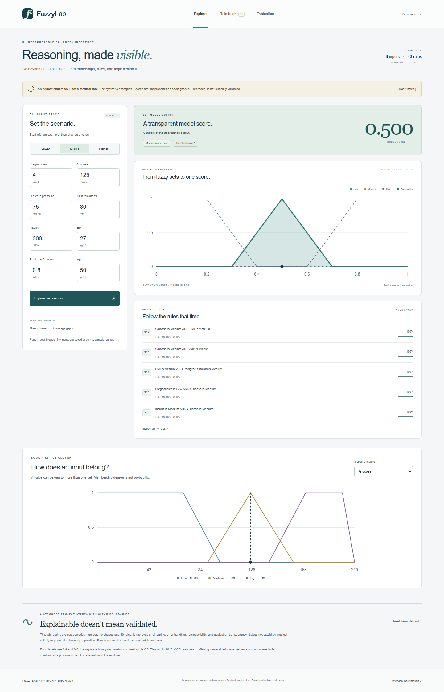

# FuzzyLab · Explainable Diabetes Fuzzy Logic

An educational Python and browser lab, enhanced from a university fuzzy-logic project. Explore the original **40 Mamdani rules**, inspect their activations and membership functions, and review evaluation with explicit denominators and abstentions.

**[Open the live explorer](https://faridkamal2004.github.io/fuzzy-diabetes-lab/)** · [Model card](docs/MODEL_CARD.md) · [Interview walkthrough](docs/INTERVIEW.md) · [Test report](docs/TESTING.md) · [Releases](https://github.com/FaridKamal2004/fuzzy-diabetes-lab/releases)



**Educational use only.** This is not a medical screening, diagnostic, or treatment tool. The model score is not a calibrated probability. Use synthetic examples, not personal health information.

## What changed

| Original | Enhanced implementation |
| --- | --- |
| Notebook-only `!pip install` and runtime Kaggle download | Installable Python package, explicit CLI, no networking at import, zero core runtime dependencies |
| Long script coupling definitions, plots, inference and evaluation | Shared declarative model, stateless numerical engine, evaluation module, CLI and browser explorer |
| Bare `except` and dropped failed rows | Named validation/coverage errors and explicit abstention counts |
| Zero-valued measurements treated as ordinary low inputs | Strict missing-value handling by default; separately labeled train-fitted median imputation for benchmark evaluation |
| Floating-point ambiguity around threshold 0.5 | Documented 1e-12 tie convention; no silent label changes across Python and JavaScript |
| Accuracy alone | Confusion matrix, recall, specificity, precision, F1, coverage and majority baseline |
| Implicit sampled defuzzification | Exact piecewise-linear max/min envelope and centroid, cross-checked with a dense scikit-fuzzy reference |
| Static plots | Interactive output curve, centroid marker, per-feature memberships and searchable rule traces |
| No automated delivery | Python, numerical parity, desktop/mobile and accessibility tests before GitHub Pages/release publishing |

The membership shapes and all 40 original AND-rule definitions are retained. This is an engineering and evaluation enhancement, **not a claim of better clinical accuracy**.

## Run Python

Requires Python **3.11 or newer**:

```sh
python -m venv .venv
# Windows: .venv\Scripts\activate
# macOS/Linux: source .venv/bin/activate
python -m pip install -e .
python -m fuzzy_diabetes explain examples/scenario.json
```

The core needs only Python's standard library. `explain` returns the score, demonstration class, model band, input memberships, fired rules, aggregate strengths and envelope vertices. Invalid or incomplete scenarios return structured JSON on stderr and exit code 2. Unknown fields, including `Outcome`, are rejected.

Alternatively install the wheel from GitHub Releases with `python -m pip install <downloaded-wheel.whl>`.

## Evaluate your local benchmark copy

The input CSV must have exactly these columns:

```text
Pregnancies,Glucose,BloodPressure,SkinThickness,Insulin,BMI,DiabetesPedigreeFunction,Age,Outcome
```

```sh
python -m fuzzy_diabetes evaluate "path/to/Diabetes Dataset.csv" --output reports/my-evaluation.json
```

The supplied archive's raw CSV and row-level predictions are deliberately not redistributed. The [original project's Kaggle source](https://www.kaggle.com/datasets/akshaydattatraykhare/diabetes-dataset) is documented; obtain a local copy under its applicable terms or use the CSV supplied with the original project. No runtime Kaggle credentials or automatic downloads are needed. [DATA.md](docs/DATA.md) records the checksum and schema used for the published aggregate report.

Evaluation uses a deterministic class-stratified 80/20 split, seed 42. Five zero-coded measurement columns are median-imputed using **training rows only**; rules and threshold stay fixed. A strict abstaining comparison and a training-majority baseline are also reported. Since the original rules were designed using this dataset, the split is not untouched external validation.

## Measured benchmark results

| Policy | Scored / attempted | Accuracy on scored | Recall | F1 |
| --- | --- | --- | --- | --- |
| Training-median imputation | 154 / 154 | 67.53% | 68.52% | 0.597 |
| Strict missing-data handling | 76 / 154 | 68.42% | 61.54% | 0.571 |
| Training-majority baseline | 154 / 154 | 64.94% | 0.00% | 0.000 |

Strict handling abstains on **78** holdout records; its apparent accuracy must not be compared without that coverage. No confidence intervals or clinical validation are claimed. See [the complete aggregate report](reports/evaluation.json).

The original export contains 558 correct labels out of 768 (72.66%), but that is a historical full-data result, not the new holdout result. It contains 147 scores within 1e-12 of 0.5; 115 exported classes differ from the new explicit tie convention. The exact engine also detects four uncovered full-data scenarios in legacy zero mode. Those differences are disclosed rather than hidden or relabeled as an accuracy improvement.

## Run and test the browser lab

Node.js 22+ is needed for browser tooling only:

```sh
npm ci
node scripts/serve.mjs
```

Open `http://127.0.0.1:4175/`. The website runs locally in the browser and has no backend, analytics, local storage, or remote inference API. GitHub Pages serves the same static assets. Do not open `index.html` directly as a `file://` URL; its modules and JSON assets need HTTP.

```sh
python -m pip install -e ".[test]"
python scripts/build_site.py --check
python -m unittest discover -s tests -v
npm test
npx playwright install chromium
npm run test:e2e
```

The test extra installs pinned numerical reference libraries only for verification and plotting. On Linux, `npx playwright install --with-deps chromium` installs the necessary system libraries. `python scripts/build_site.py` refreshes generated model/report assets and synthetic parity cases; `--check` catches stale copies in CI.

## Interview demo

1. Switch between the lower, middle and higher **synthetic** examples.
2. Follow an activated rule from its input memberships to the aggregate output and centroid.
3. Show **Missing value** and **Coverage gap**. Explain why abstaining is better than inventing a score.
4. Search the 40-rule book and show active rules only.
5. Compare evaluation policies and discuss coverage, the majority baseline and dataset limitations.
6. Open the Python/browser parity tests and independent scikit-fuzzy comparison.

See [INTERVIEW.md](docs/INTERVIEW.md) for a three-minute script and questions to practice.

## Provenance and scope

This began as university group coursework. The enhancement was developed with AI assistance; review the code and understand its numerical and evaluation choices before presenting it. The original report and slides, personal/student identifiers, raw benchmark records and original row-level classifications are not published. [Provenance](docs/PROVENANCE.md) distinguishes source material from user instructions and identifies retained and changed behavior.

There is no clinical validation, calibration, external cohort validation, fairness assessment, model training, real patient workflow, or medical recommendation. Model ranges and labels are coursework parameters, not clinical cutoffs. Third-party licenses are described in [THIRD_PARTY.md](THIRD_PARTY.md); no new blanket license is asserted over the original group's work.
